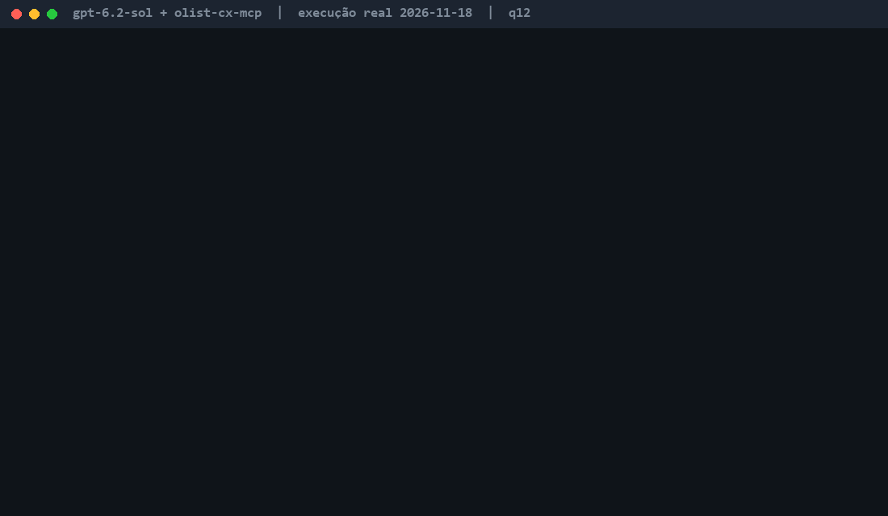
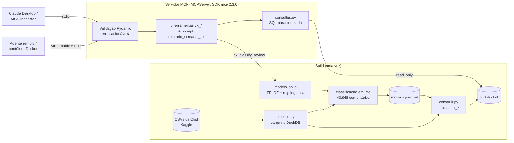

# olist-cx-mcp

Servidor [MCP](https://modelcontextprotocol.io) em Python que dá a agentes de IA acesso **somente leitura**
às avaliações de clientes do [dataset público da Olist](https://www.kaggle.com/datasets/olistbr/brazilian-ecommerce),
já classificadas por motivo de reclamação.




*Execução real da avaliação (`gpt-6.2-sol`, pergunta q12): as chamadas e a resposta são as do modelo,
registradas em [`eval/resultados/`](eval/resultados/); os resumos das ferramentas foram reproduzidos com as
mesmas chamadas ([`scripts/gerar_gif.py`](scripts/gerar_gif.py)).*

## Problema

Um analista de experiência do cliente (CX) quer respostas como "os clientes do RJ reclamam mais de atraso?"
ou "qual vendedor concentra reclamações de produto errado?". Os dados para isso existem, mas estão espalhados
em seis tabelas, e o *motivo* da insatisfação está em texto livre. Um agente de IA com SQL aberto pode errar
joins, inventar definições (o que é "atraso"?) ou, pior, escrever no banco.

Este servidor resolve isso com:

- **um motivo por avaliação**, previsto por um classificador treinado no meu projeto
  [`fine-tuning-hugging-face`](https://github.com/AbnerRidigolo/fine-tuning-hugging-face);
- **cinco ferramentas de alto nível**, com definições fixas e documentadas, em vez de SQL livre;
- **garantias**: somente leitura, consultas só parametrizadas, entradas validadas, erros que dizem ao
  agente como corrigir a chamada.

## Arquitetura



## Ferramentas

Todas têm `readOnlyHint: true`, `outputSchema` e devolvem **JSON estruturado + um resumo em texto**. Todo
campo de entrada tem descrição e exemplo.

| Ferramenta | O que responde | Paginação |
|---|---|---|
| `cx_search_reviews` | Avaliações com filtros: motivo, trecho de texto (ignora acentos), UF do cliente ou do vendedor, vendedor, categoria, nota, período | `limit` (até 50) / `offset` |
| `cx_reason_breakdown` | Distribuição dos motivos, com quebra por UF, categoria, vendedor, mês ou nota; ordena pelo % de um motivo | `limit` (até 100) / `offset` |
| `cx_seller_profile` | Perfil do vendedor: volume, receita, categorias, nota, motivos e atraso, comparados com a plataforma, e reclamações recentes | `limit` / `offset` das reclamações |
| `cx_delivery_delay_stats` | Taxa de atraso, dias de atraso, nota de pedidos atrasados vs no prazo, % de reclamações de atraso; quebra por UF, rota, categoria, vendedor ou mês | `limit` (até 100) / `offset` |
| `cx_classify_review` | Classifica um comentário novo com o mesmo modelo usado no dataset | não se aplica |

**Prompt:** `relatorio_semanal_cx(semana_inicio, estado_cliente?)` é um roteiro de 5 passos com as
ferramentas, que compara a semana com a anterior e devolve o relatório num formato fixo.

**Erros que ensinam o agente a corrigir a chamada** (mensagens reais):

```text
cx_search_reviews: Argumentos inválidos. estado_cliente: estado inválido ('São Paulo'); use a sigla de 2 letras, como SP, RJ ou MG. Corrija e chame a ferramenta de novo.
cx_delivery_delay_stats: categoria desconhecida ('relógios e presentes'); use o nome do dataset em snake_case, como cama_mesa_banho ou beleza_saude; parecidas: artes_e_artesanato, artigos_de_festas, artigos_de_natal, relogios_presentes, seguros_e_servicos. Para listar categorias, use cx_reason_breakdown com agrupar_por='categoria'
```

**Segurança:** todo valor vindo do agente entra como parâmetro `?`. As partes do SQL que variam (filtros,
agrupamento, ordenação) saem de dicionários constantes, escolhidas por valores já validados como `Literal`.
A conexão DuckDB é aberta com `read_only=True`.

## Dados e classificador

Base: 99.441 pedidos, 112.650 itens, 3.095 vendedores, 99.224 avaliações (2016-10 a 2018-08). Das
avaliações, **40.968 têm comentário** e receberam um motivo:

| Motivo | Avaliações | % | Nota média |
|---|---:|---:|---:|
| elogio | 23.586 | 57,6 | 4,72 |
| atraso_ou_nao_entrega | 5.688 | 13,9 | 1,89 |
| produto_errado_ou_incompleto | 4.382 | 10,7 | 1,95 |
| qualidade_abaixo_do_esperado | 2.760 | 6,7 | 2,96 |
| defeito_ou_avaria | 1.885 | 4,6 | 2,39 |
| atendimento_vendedor | 1.339 | 3,3 | 2,00 |
| outro | 1.328 | 3,2 | 3,23 |

Fonte: [`reports/fase0_distribuicao.json`](reports/fase0_distribuicao.json). O classificador é um baseline
TF-IDF + regressão logística, com acurácia de 0,812 e F1 macro de 0,760 no conjunto de teste (detalhes em
[`models/README.md`](models/README.md)). Ele fica atrás de uma interface (`Classificador`) para ser trocado
pelo BERTimbau sem mudar as ferramentas.

## Como rodar (Windows / PowerShell)

Requer Python 3.11.

```powershell
py -3.11 -m venv .venv; .\.venv\Scripts\Activate.ps1
python -m pip install -r requirements.txt
python -m pip install --no-deps -e .
Copy-Item .env.example .env

# baixa o dataset público (Kaggle, sem token) e monta o banco: CSV -> DuckDB -> motivos -> tabelas cx_*
python scripts\fase0_baixar.py
python -m olist_cx_mcp.pipeline
```

**stdio** (uso local):
```powershell
python -m olist_cx_mcp
```

**Streamable HTTP:**
```powershell
python -m olist_cx_mcp --transport streamable-http --port 8000   # endpoint: http://127.0.0.1:8000/mcp
```

**Docker** (o build baixa o dataset e monta o banco; a imagem final tem 591 MB e roda sem root):
```powershell
docker build -t olist-cx-mcp .
docker run --rm -p 8000:8000 olist-cx-mcp
python scripts\verificar_http.py http://127.0.0.1:8000/mcp
```

**MCP Inspector:**
```powershell
npx -y @modelcontextprotocol/inspector@2.14.0 .\.venv\Scripts\python.exe -m olist_cx_mcp
```

**Claude Desktop:** em `%APPDATA%\Claude\claude_desktop_config.json`, dentro de `"mcpServers"`:
```json
"olist-cx": {
  "command": "C:\\caminho\\para\\olist-cx-mcp\\.venv\\Scripts\\python.exe",
  "args": ["-m", "olist_cx_mcp"]
}
```

**Testes:**
```powershell
python -m pip install -r requirements-dev.txt
$env:PYTHONUTF8 = "1"; python -m pytest -q
```

São 58 testes, que rodam na CI no Ubuntu e no Windows, mais o build da imagem Docker com uma chamada via
HTTP. Os testes das ferramentas usam um banco sintético cujos números esperados foram calculados à mão.

## Avaliação

**Método** ([`eval/`](eval/)): 14 perguntas de analista de CX, cada uma exigindo pelo menos duas chamadas.
O gabarito de cada pergunta é calculado por SQL direto nas tabelas brutas, sem as tabelas `cx_*` nem o
código das ferramentas, e o script confere que não há empates. As perguntas q11 a q14 usam linguagem de
analista, sem nomes de ferramentas, escrevem estado e categoria por extenso ("Minas Gerais", "relógios e
presentes") e exigem paginação (q14: 145 vendedores, com no máximo 100 por página).

O executor ([`eval/rodar.py`](eval/rodar.py)) sobe o servidor por stdio, deixa o modelo chamar as
ferramentas e compara a resposta final (JSON) com o gabarito: textos sem acento e sem caixa, números com
tolerância de ±0,15 p.p. e contagens exatas.

**Resultados** (`gpt-6.2-sol`, esforço `medium`, 3 rodadas, 2026-11-17):

| | 14 perguntas |
|---|---|
| Acertos | **42/42** (41/42 na correção original, que exigia acento igual: o modelo escreveu "Rolândia" e o dataset grava "rolandia") |
| Chamadas por pergunta | **2,71** em média (de 2 a 9) |
| Erros de ferramenta | 0 |
| Custo | **US$ 0,31** no total, US$ 0,0073 por pergunta |
| Tokens | 93.408 de entrada + 488.692 de entrada em cache + 7.035 de saída |

Fontes: [`eval/resultados/gpt-6.2-sol_medium_20261117_222050.json`](eval/resultados/gpt-6.2-sol_medium_20261117_222050.json)
(execução) e `..._recorrigido.json` (mesma execução com a correção sem acento). Uma primeira versão com 10
perguntas teve 30/30 acertos e 2,03 chamadas por pergunta (US$ 0,19). Como duas daquelas perguntas cabiam
numa chamada só, eu as substituí.

Na q14, o modelo não leu as páginas inteiras: fez uma busca binária com `limit=1` e `offset` para achar o
ponto em que o percentual cruza 25%.

## Limitações

- **Os motivos são previsões de um baseline, não rótulos humanos.** O F1 vai de 0,52 (`outro`) a 0,88
  (`elogio`), e a referência de teste também foi rotulada por LLM. Há erros visíveis quando a confiança é
  baixa: 38,9% das previsões de `outro` têm confiança abaixo de 0,5.
- **Só a mensagem do comentário é classificada.** As 1.729 avaliações que têm título mas não têm mensagem
  ficam sem motivo.
- **Definição de atraso:** entrega em data posterior à data estimada, comparando por dia. Isso dá 6,8% na
  plataforma; análises que comparam horário contam como atraso a entrega no próprio dia estimado e chegam a
  um número maior.
- **Pedidos com vários vendedores ou categorias:** a avaliação conta para cada um (1.278 pedidos têm mais
  de um vendedor). Filtros por vendedor e por categoria ao mesmo tempo valem no nível do pedido.
- **A avaliação não exercitou a recuperação de erros.** O modelo converteu os nomes por extenso sozinho e
  não houve nenhum erro de ferramenta; as mensagens de erro estão cobertas pelos testes, não pela avaliação.
- **A avaliação cobre um modelo só**, e com uma taxa de acerto tão alta as perguntas ainda não separam bem
  modelos fortes. Comparar modelos e criar perguntas mais ambíguas fica como trabalho futuro.
- **Dados históricos (2016–2018).** O prompt semanal funciona com datas desse período.

## Estrutura

```text
src/olist_cx_mcp/   servidor.py (ferramentas, prompt, erros), consultas.py (SQL), esquemas.py (Pydantic),
                    classificador.py, pipeline.py, construir.py, __main__.py (stdio / HTTP)
eval/               perguntas.py (perguntas + gabarito SQL), rodar.py, recorrigir.py, resultados/
tests/              pytest por ferramenta, transportes e executor da avaliação
scripts/            download, etapas do pipeline, verificação HTTP, gerador do GIF
models/motivo/      modelo.joblib (versionado)
```

## Licença e créditos

Dados: [Brazilian E-Commerce Public Dataset by Olist](https://www.kaggle.com/datasets/olistbr/brazilian-ecommerce),
CC BY-NC-SA 4.0. O banco e o modelo derivados seguem a mesma licença, com crédito à Olist.
